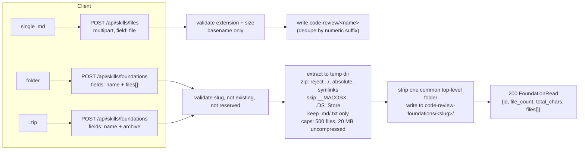
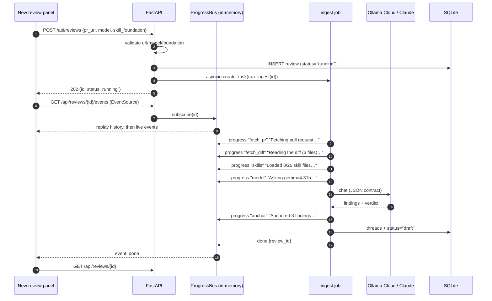

# Phase 7 — Skill Management & Process Visibility

## Objective & Scope

Give the operator control over *which* review standards the model applies, make uploading those
standards a first-class action, and replace the review's blind spinner with a live account of
what the model is doing.

**In scope**

- **Skills tab (`/skills`)**: browse the skill library, upload a single `.md`/`.txt` into the
  default `code-review/` folder, and create additional **Core Skill Foundations** — a named
  folder of rule files — by uploading a folder or a `.zip` the backend extracts safely.
- Foundations are discovered from disk (no second source of truth); the original `code-review/`
  is the protected default.
- **Foundation selection per review**: the dashboard's new-review panel gains a dropdown,
  defaulting to the original folder; the choice is stored on the review and reused for that
  review's discussions.
- **Live process visibility**: review creation becomes asynchronous. `POST /api/reviews` returns
  `202` with an id, a background job runs the pipeline, and `GET /api/reviews/{id}/events`
  streams Server-Sent Events for each stage ("Fetching pull request…", "Reading 8 skill files…",
  "Asking gemma4:31b…", "Anchoring 3 findings…", done). The frontend renders the real steps, and
  the static loading sentence is removed.
- **Copy Context**: every comment card gets a copy action that puts `path:line` + the diff
  context on the clipboard.

**Out of scope**

- Editing skill file contents in the browser (upload/delete only).
- Multiple foundations applied at once, inheritance, or per-language routing.
- Streaming the model's raw tokens; the stream carries *stages and counts*, not partial output.
- Cross-referencing, verdict suggestion and summarisation — Phase 8.
- Multi-process/worker deployments: the event bus is in-process (documented limitation).

## High-Level Design

### Skill storage layout

```
code-review/                      ← default foundation (id: "code-review"), protected
  SKILL.md
  references/**/*.md
code-review-foundations/          ← created on first upload (FOUNDATIONS_DIR)
  frontend-guidelines/            ← uploaded foundation (id: "frontend-guidelines")
    react.md
    accessibility.txt
  payments/                       ← another foundation
    rules.md
```

A foundation id is its directory name, slug-validated (`^[a-z0-9][a-z0-9-_]{0,49}$`). Discovery
is `GET /api/skills`, which scans both roots on every call — deleting a folder by hand makes it
disappear from the API, so the filesystem stays authoritative.

### Upload pipeline



### Asynchronous ingest with SSE



Failure path: a `PipelineError` marks the review `failed`, stores the message in `error`, and
publishes `event: error` before the stream closes. A server restart marks any orphaned
`running` rows as `failed` ("Interrupted by a server restart") on startup, so the dashboard
never shows a job that can never finish.

### Progress event contract

```json
{ "seq": 4, "ts": "2026-11-07T06:22:41.512Z", "stage": "skills",
  "label": "Reading skill files", "detail": "Loaded 8 of 26 files from code-review",
  "level": "info", "progress": 35 }
```

Stages in order: `queued → fetch_pr → fetch_diff → parse_diff → skills → prompt → model →
parse → anchor → persist → done` (or `error`). `progress` is a coarse 0–100 hint for the bar.

## API Contracts & Database Schema Updates

### Migration `0004_skill_foundation`

```python
op.add_column("code_reviews", sa.Column("skill_foundation", sa.Text(), nullable=True))
# existing rows used the only foundation that existed:
op.execute("UPDATE code_reviews SET skill_foundation = 'code-review' WHERE skill_foundation IS NULL")
```

`status` stays a plain string column, so the new values (`running`, `failed`) need no DDL, but
their meaning is documented here:

| status | meaning |
|---|---|
| `running` | ingest job in flight; threads not yet written |
| `draft` | ingest finished, findings ready for discussion |
| `in_discussion` | at least one discussion reply landed |
| `applied` | published to GitHub |
| `failed` | ingest aborted; `error` explains why |

### `GET /api/skills`

```json
{
  "default": "code-review",
  "foundations": [
    { "id": "code-review", "label": "code-review", "is_default": true,
      "file_count": 26, "total_chars": 476112, "files": ["SKILL.md", "references/review-rubric.md", "…"] },
    { "id": "frontend-guidelines", "label": "frontend-guidelines", "is_default": false,
      "file_count": 4, "total_chars": 51200, "files": ["react.md", "a11y.md", "…"] }
  ]
}
```

Foundations are sorted default-first then by id. A foundation with no readable `.md`/`.txt`
files is still listed with `file_count: 0` so a failed upload is visible rather than invisible.

### `POST /api/skills/files`

`multipart/form-data`, field `file`. Rules: suffix ∈ `.md`, `.txt`; ≤ 2 MB; filename reduced to
its basename and slugified (`My Rules.md` → `my-rules.md`); an existing name gets `-2`, `-3`…
rather than being overwritten.

`201` → `{ "path": "code-review/my-rules.md", "foundation": "code-review", "bytes": 2311 }`
Errors: `422` unsupported type / empty / oversize; `400` no valid filename.

### `POST /api/skills/foundations`

`multipart/form-data`:

| field | required | meaning |
|---|---|---|
| `name` | yes | slug for the folder, `^[a-z0-9][a-z0-9-_]{0,49}$` |
| `files` | one of | repeated file parts; each filename may carry `sub/dir/file.md` |
| `archive` | one of | a `.zip` containing the folder |

`201` → `FoundationRead` (`id`, `label`, `is_default:false`, `file_count`, `total_chars`, `files`).
Errors: `422` invalid slug; `409` id already exists (including `code-review`); `413` archive over
20 MB uncompressed or > 500 entries; `422` archive has no `.md`/`.txt`; `422` no file part sent.

### `DELETE /api/skills/foundations/{id}`

`204` on success; `400` for the default foundation (`code-review/ is the built-in foundation`);
`404` when no such folder. Deletion removes the directory after verifying the path resolves
inside `FOUNDATIONS_DIR`.

### `POST /api/reviews` (changed)

```json
{ "pr_url": "https://github.com/o/r/pull/7", "model": "ollama-cloud:gemma4:31b",
  "skill_foundation": "frontend-guidelines" }
```

`skill_foundation` is optional and defaults to `code-review`. Unknown foundation → `422`.
Response is now `202`:

```json
{ "id": 12, "status": "running", "skill_foundation": "frontend-guidelines" }
```

`GET /api/reviews/{id}` additionally returns `skill_foundation`.

### `GET /api/reviews/{id}/events` (SSE)

`text/event-stream`. Event names: `progress` (payload above), `done` (`{review_id, status, thread_count}`),
`error` (`{review_id, detail}`). History is replayed first, so a client that connects late (or
reconnects) still sees the earlier steps. `retry: 2000`; a `: ping` comment every 15s keeps
proxies from idling the connection. The stream ends after a terminal event. `404` if the review
does not exist.

## Target File Map

### Backend — new

| File | Responsibility |
|---|---|
| `app/services/skills_service.py` | foundation discovery, slug rules, single-file save, zip/folder ingest, delete |
| `app/services/progress.py` | `ProgressBus`: history, publish, async subscribe, terminal events |
| `app/api/routes/skills.py` | GET/POST/DELETE endpoints |
| `alembic/versions/0004_skill_foundation.py` | `code_reviews.skill_foundation` |
| `backend/tests/test_skills_api.py` | listing, single upload, folder + zip ingestion, traversal, caps, delete guards |
| `backend/tests/test_progress.py` | bus replay + terminal behaviour, SSE endpoint shape, orphan reconciliation |

### Backend — modified

| File | Change |
|---|---|
| `app/core/config.py` | `foundations_dir`, `skill_upload_max_bytes`, `foundation_max_files`, `foundation_max_chars` |
| `app/models/review.py` | `skill_foundation` column; new status constants |
| `app/schemas/review.py` | `CreateReviewRequest.skill_foundation`, `CreateReviewAccepted`, `skill_foundation` on summaries |
| `app/api/routes/reviews.py` | async create (202 + task), SSE endpoint, foundation validation |
| `app/services/review_pipeline.py` | split into `create_running_review` + `run_ingest(review_id)` emitting progress; foundation-aware skill load |
| `app/services/skill_loader.py` | `load_bundle(..., root=foundation path)` (already supports `root`, wire it) |
| `app/services/discussion.py` | load skills from the review's foundation |
| `app/db/init_db.py` | mark orphaned `running` reviews `failed` on startup |
| `app/main.py` | nothing beyond router registration |

### Frontend — new

| File | Responsibility |
|---|---|
| `src/pages/SkillsPage.tsx` | foundations list, single-file upload, folder/zip foundation upload, delete |
| `src/components/FoundationUpload.tsx` | the two upload forms with progress + errors |
| `src/components/IngestProgress.tsx` | SSE consumer + step list/progress bar |

### Frontend — modified

| File | Change |
|---|---|
| `src/App.tsx`, `src/components/Navbar.tsx` | `/skills` route + tab |
| `src/pages/NewReviewPanel.tsx` | foundation dropdown, 202 handling, navigate on accept |
| `src/pages/ReviewDetailPage.tsx` | live progress while `running`, refresh on `done` |
| `src/components/CommentBox.tsx` | Copy Context button |
| `src/services/api.ts` | skills endpoints, `createReview` return type |
| `src/types/index.ts` | foundations, accepted-review, progress event |
| `src/pages/DashboardPage.tsx` | status badges for `running` / `failed` |

## Step-by-Step Implementation Steps

1. Migration `0004` + model column + status constants.
2. Config: `foundations_dir` (default `<repo>/code-review-foundations`), upload caps.
3. `skills_service`: slug validation, discovery, safe extraction (zip traversal/bomb guards),
   single-file save with dedupe, delete with path containment check.
4. `skills.py` routes + schemas; tests for every rejection path.
5. `progress.py`: bounded history per review, subscriber queues, terminal signalling.
6. Refactor `review_pipeline` into `create_running_review(db, payload)` and
   `run_ingest(review_id)` (own session) with `publish()` at each stage; foundation-aware skills.
7. `POST /api/reviews` → 202 + `asyncio.create_task`; SSE route; startup reconciliation for
   orphaned `running` rows.
8. Discussion uses the review's foundation.
9. Frontend: Skills page + nav; foundation dropdown; SSE progress component; copy-context button;
   badges for the new statuses.
10. Verify: pytest, build, then a live run with the mock provider where the stream shows every
    stage and the review completes.

## Verification & Acceptance Criteria

1. `pytest` passes, including: upload of a `.md` lands in `code-review/`; a `.zip` with `../evil.md`
   is rejected and writes nothing outside the foundation dir; folder upload strips the shared
   top-level folder; duplicate foundation id → 409; deleting `code-review` → 400; `.exe` upload →
   422; caps enforced.
2. `alembic upgrade/downgrade` round-trips `0004`; a pre-existing review row ends with
   `skill_foundation = 'code-review'`.
3. `POST /api/reviews` returns `202` immediately (no model wait) with `status: "running"`; the
   review reaches `draft` with threads, and `GET …/events` replays every stage in order.
4. The SSE stream emits `progress` events for fetch, skills, model and anchor, then exactly one
   `done`; a failing model call emits `error` and leaves `status: "failed"` with the message.
5. A review created with `skill_foundation: "frontend-guidelines"` loads that foundation's files
   (asserted on the prompt built in a unit test) and stores the id; a discussion on that review
   uses the same foundation after the default is changed.
6. The UI shows a live step list during ingest and the review without a manual reload; the
   static "The model reads the diff…" sentence is gone.
7. Copy Context puts `<path>:<line>` plus the hunk on the clipboard (verified via the browser's
   clipboard read in the live run).
8. Restarting the backend while a review is `running` leaves it `failed` with the restart note.
