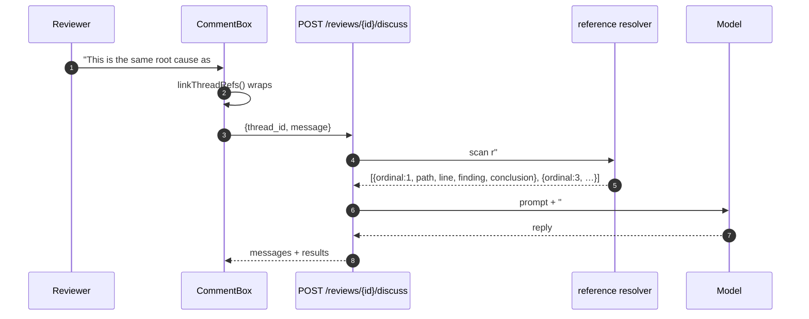
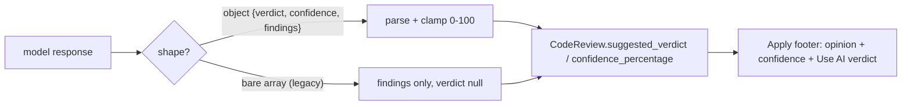

# Phase 8 — Cross-Referencing, Verdict Opinion & Finalisation

## Objective & Scope

Make discussions aware of each other, let the model state an opinion about the PR as a whole,
and turn a long conversation into a short, publishable GitHub review — dropping threads the
model ultimately conceded on.

**In scope**

- **`#N` cross-references.** A reviewer can mention another thread by its ordinal
  ("same problem as #1"). The backend resolves every `#N` in a submitted message to that
  thread's file, line, original finding and latest conclusion, and appends a
  "Referenced threads" block to the discussion prompt. Out-of-range numbers are ignored and
  reported in the reply metadata. The UI renders `#N` as a highlighted, clickable chip that
  scrolls to that thread.
- **Verdict opinion + confidence.** The review-generation contract becomes
  `{verdict, confidence, findings[]}` (a bare array is still accepted). Both values are stored
  and surfaced in the sticky footer with a one-click "Use AI verdict" action.
- **Summarise-and-prune before publishing.** A pre-pass model call turns each thread into one
  GitHub-ready comment and may flag it for removal when the AI finding was withdrawn during
  discussion. Dropped threads are not posted. The pass is best-effort: on failure the
  deterministic collation is used and the operator is warned.
- **Mandated PR body.** The review body becomes exactly
  `Code review completed with {n} inline findings, discussed and verified by human - By Code Review Master`,
  where `n` is the number of comments that survived pruning. The free-text summary input is
  removed from the action bar and replaced by a read-only preview of that sentence.

**Out of scope**

- Threads created by the operator from scratch; editing a stored summary by hand.
- Re-running the summariser after publishing (GitHub reviews are immutable).
- Cross-referencing a thread from a different review (ids are per-review ordinals).
- Localisation of the mandated sentence.

## High-Level Design

### Discussion with references



### Verdict and confidence in the ingest contract



### Publish pipeline with summarise + prune

```mermaid
sequenceDiagram
    autonumber
    participant U as Operator
    participant A as POST /reviews/{id}/apply
    participant S as summariser
    participant L as Model
    participant DB as SQLite
    participant GH as GitHub

    U->>A: {event}
    A->>DB: load threads + token
    A->>A: guard: not applied, commit_id present
    A->>S: candidate threads (assistant message + conversation)
    S->>L: "summarise each thread; drop ones you conceded"
    L-->>S: [{thread_id, summary, drop, reason}]
    S->>DB: persist review_threads.summary / .dropped
    A->>A: comments = non-dropped, body = summary
    A->>GH: GET current diff → re-validate anchors
    A->>GH: POST review {commit_id, event, body: mandated sentence, comments}
    A->>DB: status=applied, verdict, url
    A-->>U: {review, url, comments_posted, warnings}
```

On summariser failure: log it, publish warnings `"Summarisation failed (…); used the last message of each thread."`, and fall back to `collate_comments` (last assistant message, `**AI Review Conclusion:**` prefix when discussed). Publishing is never blocked by the pre-pass.

## API Contracts & Database Schema Updates

### Migration `0005_review_intelligence`

```python
op.add_column("code_reviews", sa.Column("suggested_verdict", sa.String(32), nullable=True))
op.add_column("code_reviews", sa.Column("confidence_percentage", sa.Integer(), nullable=True))
op.add_column("review_threads", sa.Column("summary", sa.Text(), nullable=True))
op.add_column("review_threads", sa.Column("dropped", sa.Boolean(), server_default=sa.false(), nullable=False))
```

| Column | Meaning |
|---|---|
| `code_reviews.suggested_verdict` | model's opinion: `APPROVE` / `COMMENT` / `REQUEST_CHANGES` |
| `code_reviews.confidence_percentage` | 0–100, nullable when the model omitted it or returned a legacy array |
| `review_threads.summary` | the GitHub-ready comment produced by the pre-pass |
| `review_threads.dropped` | true when the model withdrew the finding; excluded from the payload |

### Model output (review generation)

```json
{
  "verdict": "REQUEST_CHANGES",
  "confidence": 85,
  "findings": [
    { "filePath": "src/services/auth.py", "lineNumber": 42,
      "diffHunk": "@@ …", "initialComment": "**Critical** — …" }
  ]
}
```

Accepted alternatives: bare `[...]` (legacy), `{"findings": [...]}` without verdict, `confidence`
as `"85"` or `85`, verdict lowercase (normalised). Unknown verdict values are dropped, and a
confidence outside 0–100 is clamped.

### Model output (summarise + prune)

```json
{
  "threads": [
    { "thread_id": 21, "summary": "Fixed in 8a1c: JWT verification now pins HS256.", "drop": false },
    { "thread_id": 43, "summary": "", "drop": true, "reason": "Reviewer showed the guard already exists." }
  ]
}
```

Unknown ids are ignored; a thread missing from the response keeps the deterministic comment.
A dropped thread with no reason still drops (the summary is not needed).

### `POST /api/reviews/{id}/discuss` — unchanged shape, richer prompt

Request unchanged. The response gains `references` on each result:

```json
{ "thread_id": 21, "ok": true, "error": null, "references": [1, 3] }
```

### `POST /api/reviews/{id}/apply` — request loses `body`

```json
{ "event": "REQUEST_CHANGES", "thread_ids": [21, 22] }
```

The posted body is always:

```
Code review completed with {n} inline findings, discussed and verified by human - By Code Review Master
```

with `n = comments_posted`. Response gains `summarised: true|false` and `dropped: [thread_ids]`.

### `GET /api/reviews/{id}` — additions

`CodeReviewDetail` gains `suggested_verdict`, `confidence_percentage`; each thread gains
`summary`, `dropped`, and `ordinal` (1-based position, what `#N` refers to).

## Target File Map

### Backend — new

| File | Responsibility |
|---|---|
| `app/services/references.py` | `find_references(message, threads)`, `format_references_block` |
| `app/services/summarise.py` | `summarise_threads(db, review, threads)` → summaries + drops, best-effort |
| `alembic/versions/0005_review_intelligence.py` | the four columns |
| `backend/tests/test_references.py` | ordinal parsing, block content, out-of-range handling |
| `backend/tests/test_summarise.py` | apply with pruning, mandated body, failure fallback |

### Backend — modified

| File | Change |
|---|---|
| `app/models/review.py` | `suggested_verdict`, `confidence_percentage`, `summary`, `dropped` |
| `app/schemas/review.py` | `ReviewResult`, `ApplyRequest` (no `body`), `DiscussResult.references`, thread/detail fields |
| `app/services/prompts.py` | verdict+confidence in the contract; reference block in the discussion prompt |
| `app/services/llm_service.py` | `extract_review_result` (object or legacy array) |
| `app/services/review_pipeline.py` | persist verdict/confidence |
| `app/services/discussion.py` | resolve references, return them per result |
| `app/services/apply_service.py` | summarise → prune → mandated body → post |
| `app/services/skills_service.py` | (unchanged) |

### Frontend — modified

| File | Change |
|---|---|
| `src/components/CommentBox.tsx` | `linkThreadRefs` rendering + clickable `#N` chips |
| `src/components/StickyActionBar.tsx` | AI verdict + confidence block, read-only body preview, remove summary input |
| `src/pages/ReviewDetailPage.tsx` | pass thread count, adopt AI verdict, show dropped badges, new apply response |
| `src/services/api.ts`, `src/types/index.ts` | new fields, `applyReview` without body |
| `src/components/ReviewHeader.tsx` | AI verdict chip |
| `src/lib/utils.ts` | `linkThreadRefs` |

## Step-by-Step Implementation Steps

1. Migration `0005` + model columns.
2. `extract_review_result` + prompt contract with `verdict`/`confidence`; persist on ingest.
3. `references.py`: ordinal scan (1-based over `review.threads`), block formatter; wire into
   `build_discussion_user_prompt` and `DiscussResult.references`.
4. `summarise.py`: prompt, JSON parse, validation, persistence of `summary`/`dropped`;
   fallback path returning `None` so apply can collate deterministically.
5. `apply_service`: call the pre-pass, build comments from summaries, drop flagged threads,
   generate the mandated body, extend the response (`summarised`, `dropped`).
6. Frontend: chip rendering, AI verdict/confidence in the bar, body preview, dropped badges.
7. Tests for every contract including the exact sentence and the exclusion of dropped threads.
8. Live run: discuss with a `#1` reference, check the prompt received the block, apply, assert
   the recorded GitHub payload.

## Verification & Acceptance Criteria

1. `pytest` passes; `alembic upgrade/downgrade` round-trips `0005`.
2. A model response as an object stores `suggested_verdict="REQUEST_CHANGES"` and
   `confidence_percentage=85`; a bare array leaves both null and still stores findings.
3. Submitting "this is like #1 and #9" resolves only `#1`; the discussion prompt contains the
   referenced thread's path, line and latest conclusion; the response reports `references: [1]`.
4. In the UI, `#1` renders as a chip; clicking it scrolls to thread 1. Typing `#1` and
   submitting produces a reply that acknowledges the referenced finding.
5. Apply with one dropped thread posts `n = total - dropped` comments, each body equal to the
   stored summary, and the review body matches the mandated sentence character for character.
6. Dropped threads are absent from the GitHub payload (asserted against the recorded request)
   and flagged in the UI.
7. A failing summariser still publishes, using last-message collation, with a warning.
8. Re-applying remains `409`; a failed GitHub call leaves `status`/`verdict` unchanged.
