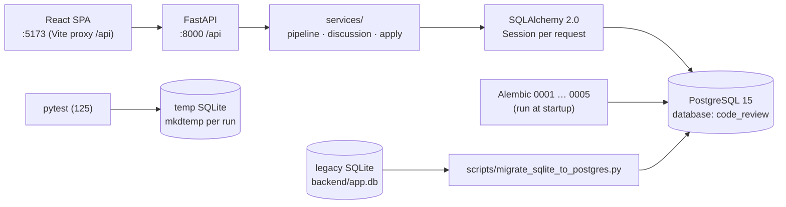
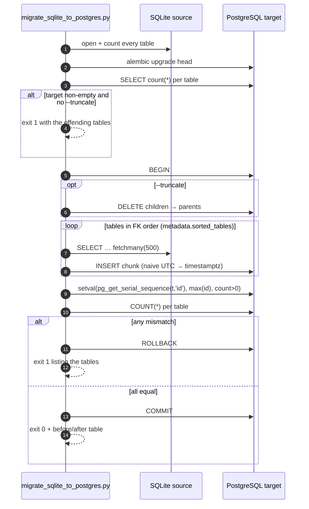
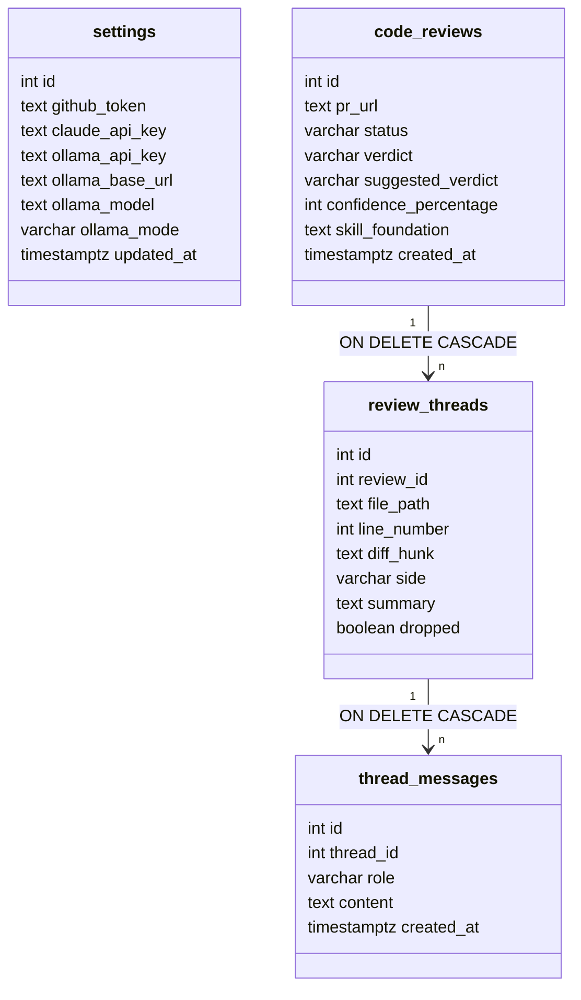

# Phase 9 — PostgreSQL as the Application Database

> Written after the work landed, at the operator's request, so the change is on record in the
> same format as phases 1–8. The plan below is what was executed and verified.

## Objective & Scope

Move the runtime store from SQLite to PostgreSQL, and give an existing SQLite installation a
one-command path to the new database. The application code stays dialect-agnostic: models keep
using `Text`, `Integer`, `String(n)` and `DateTime(timezone=True)`, and Alembic remains the only
source of truth for schema.

**In scope**

- PostgreSQL is the default `DATABASE_URL`; `psycopg` 3 is a declared dependency.
- The five existing migrations run unchanged on PostgreSQL (verified, no new revision).
- `backend/scripts/migrate_sqlite_to_postgres.py`: a rake-style task that copies every table,
  refuses a non-empty target, preserves primary keys and timestamps, resets id sequences, and
  verifies counts inside one transaction.
- SQLite stays supported — the test suite depends on it, and it remains a legitimate throwaway
  local database.
- README, `.env.example`, `.env` and the test suite describe the new default.

**Out of scope**

- PostgreSQL → SQLite (down-migration of data). Only the schema has `alembic downgrade`.
- Connection pooling/HA tuning; the local app keeps SQLAlchemy's defaults with `pool_pre_ping`.
- Multi-tenant or role-based access; the database is owned by the local OS user.
- Moving the skill library or uploaded foundations into the database (they stay on disk).

## High-Level Design

### Runtime topology



### Migration task



### Why the schema did not change



`settings` holds a single row (`id = 1`, no sequence). The other three use `serial` primary keys,
which is why a bulk copy must reset their sequences afterwards.

The SQLite-only `PRAGMA foreign_keys=ON` hook in `app/db/session.py` already runs conditionally;
PostgreSQL enforces the same cascades natively, so no model edits were needed.

## API Contracts & Database Schema Updates

**No endpoint changes.** The HTTP surface is identical; only the storage behind it moved. There
is also **no new Alembic revision** — a deliberately empty migration would have added noise, and
the existing ones were confirmed executable on PostgreSQL.

### Changed configuration contract

| Variable | Before | After |
|---|---|---|
| `DATABASE_URL` | `sqlite:///./app.db` | `postgresql+psycopg://localhost:5432/code_review` |
| Driver | stdlib `sqlite3` | `psycopg[binary]==3.2.3` (added to `requirements.txt`) |

Resolution rules are unchanged: non-SQLite URLs pass through untouched, `sqlite:///./x.db`
resolves against `backend/`, and `sqlite:////abs/path.db` (four slashes) is absolute.

### Behavioural differences to keep in mind

| Concern | SQLite | PostgreSQL |
|---|---|---|
| Primary keys | `INTEGER PRIMARY KEY` (rowid alias) | `serial` + sequence; bulk copies need `setval` |
| Timestamps | `DateTime(timezone=True)` stored as naive wall time | `timestamptz`; naive values are read in the session zone |
| Cascades | needs `PRAGMA foreign_keys=ON` per connection | always enforced |
| `String(n)` / `Text` | unenforced | enforced at `varchar` length |
| DDL in a transaction | not supported (`non-transactional DDL` warning) | transactional, so a failed migration rolls back |

### Script interface

```bash
python scripts/migrate_sqlite_to_postgres.py [--source URL] [--target URL] [--truncate] [--dry-run]
```

| Flag | Default | Meaning |
|---|---|---|
| `--source` | `sqlite:///<backend>/app.db` | SQLite database to read; must exist |
| `--target` | `DATABASE_URL` | PostgreSQL URL to write; must not be SQLite |
| `--truncate` | off | required when the target already holds rows |
| `--dry-run` | off | print the row plan, write nothing |

Exit codes: `0` success, `1` for a missing source, a SQLite target, identical endpoints, or a
non-empty target without `--truncate`.

## Target File Map

### Changed

| File | Change |
|---|---|
| `backend/app/core/config.py` | `database_url` default is now the PostgreSQL DSN |
| `backend/app/main.py` | startup logs the resolved database URL and skills directory |
| `backend/requirements.txt` | `psycopg[binary]==3.2.3` |
| `backend/.env.example` | PostgreSQL default, SQLite documented as the alternative |
| `backend/.env` | local DSN (gitignored) |
| `README.md` | requirements, quick start (`createdb`), env table, migration section |

### New

| File | Purpose |
|---|---|
| `backend/scripts/migrate_sqlite_to_postgres.py` | the copy task described above |
| `backend/tests/test_db_migration_script.py` | URL resolution, UTC re-attachment, refusal guards |

### Untouched on purpose

`backend/alembic/versions/*` (no schema change), `backend/app/models/*`, every route, every
frontend file, and the SQLite-only branch in `app/db/session.py` (the test suite uses it).

## Step-by-Step Implementation Steps

1. **Driver.** Added `psycopg[binary]==3.2.3`; installed into `backend/.venv`.
2. **Database.** `createdb code_review` on the locally running PostgreSQL 15
   (`/opt/homebrew/var/postgresql@15`, port 5432).
3. **Configuration.** Switched the default `DATABASE_URL`, wrote `backend/.env`, updated
   `.env.example`. `resolved_database_url` was left as is — its SQLite-relative branch simply
   stops being the default.
4. **Migrations.** `alembic upgrade head` against PostgreSQL: `0001 → 0005`, all applied, no
   dialect edits required; `alembic_version = 0005`, four tables plus the version table.
5. **Observability.** Startup now logs `Database: …` and `Skills: …`, so an unexpected empty
   database is immediately attributable to the wrong URL.
6. **Copy task.** Implemented the script: reflect both sides with SQLAlchemy, order by
   `Base.metadata.sorted_tables`, chunked `INSERT`, UTC re-attachment for `timestamptz`, sequence
   reset, count verification inside the transaction.
7. **Tests.** Added focused unit tests for the pure parts (URL resolution, timestamp coercion, the
   two refusal guards) so the suite never needs a live PostgreSQL.
8. **Docs.** README requirements/quick start/env table rewritten; a dedicated migration section
   added next to the configuration table.

## Verification & Acceptance Criteria

Run against the real local PostgreSQL, with a seeded SQLite source (2 reviews, 6 threads, 12
messages, tokens in `settings`, tz-aware timestamps, one dropped thread):

| Check | Result |
|---|---|
| `alembic upgrade head` on PostgreSQL | `0001 → 0005` applied, `alembic_version = 0005` |
| `--dry-run` | reported `code_reviews 2, settings 1, review_threads 6, thread_messages 12` (total 21), wrote nothing |
| Real run | copied 2 / 1 / 6 / 12, counts re-verified equal |
| Secrets | `github_token` and `ollama_api_key` intact in `settings` |
| Timestamps | SQLite `2026-11-07 10:30:00` → Postgres `2026-11-07 10:30:00+00` (displayed `17:30+07`); instant preserved |
| Sequences | probe inserts returned `code_reviews.id = 3` and `review_threads.id = 7` — no collision after the copy |
| Idempotency | second `--truncate` run ended at 2 / 1 / 6 / 12 |
| Guards | non-empty target without `--truncate` → exit 1 with the table list; missing source → exit 1 |
| App on PostgreSQL | `/api/health` ok; `/api/reviews` listed both migrated reviews; detail page rendered 3 code panels + 3 discussion cards + verdict `REQUEST_CHANGES 82` |
| Backend suite | 125 passed (SQLite temp database, real migrations) |
| Frontend | `npm run build` clean |

## Rollback & Risks

- **Rollback.** Point `DATABASE_URL` back at `sqlite:///./app.db`; the SQLite file is untouched by
  this phase. The copy task is one-way by design — a PostgreSQL → SQLite path does not exist.
- **Fresh clone without PostgreSQL** now fails at startup instead of silently creating a file.
  The README states the dependency and the `createdb` step.
- **Naive timestamps** are the one real trap: any future bulk import must attach UTC before
  writing to a `timestamptz` column, or every timestamp shifts by the server's offset. The script
  does this deliberately and is covered by a unit test.
- **Single-process assumptions** are unchanged: the progress bus is still in-process, so SSE
  requires one uvicorn worker. Moving to multiple workers needs a shared bus (out of scope).
